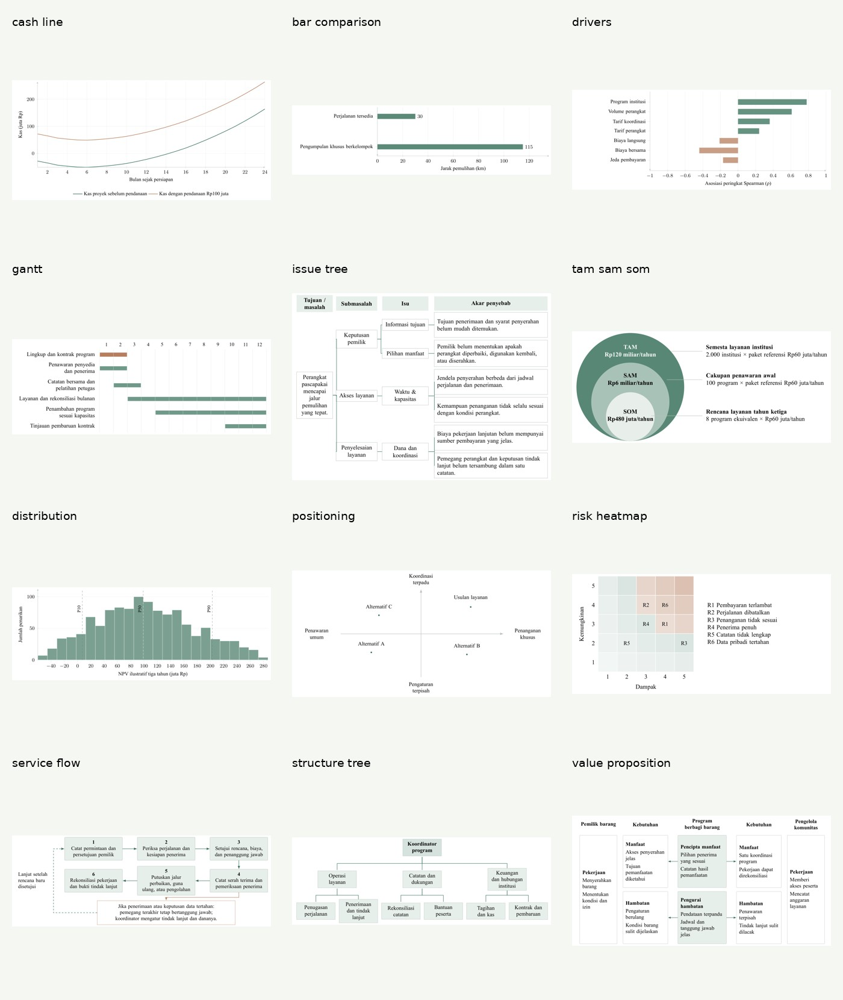

# Essay Studio

A private, repository-ready toolkit for persuasive innovation competition essays in Indonesian and English, with an optional business-plan workflow. It combines the user's writing preferences, complete supplied reference archive, V5 manual, precise chart sources, native Word production, evidence/calculation tools and a bounded review loop.



Open [the chart gallery](docs/chart-gallery.md) for full-size examples, data contracts and placed-size guidance. These overview thumbnails are navigation aids; the examples use clearly labelled illustrative data.

## Start a new task

Give a capable AI agent this instruction after providing access to the repository:

> Read AGENTS.md and load skills/write-innovation-essays/SKILL.md. Read my current brief, guidebook and supplied task documents completely, plus the full V5 manual as instructed. Use Essay Studio for my actual request below. Preserve settled decisions, ask only about consequential unresolved assumptions and remain in planning mode unless I request drafting or files.
>
> Task: [what to do]
> Language: [Indonesian / English]
> Materials: [brief, guidebook, current draft/comments, data and assets]
> Output: [discussion / outline / draft / DOCX / PDF / revision]

The agent must have file access. Rendering also needs code execution and suitable document/LaTeX tools. Automatic skill discovery varies by host; the explicit entry prompt works without claiming the skill is installed. This ZIP does not install anything or publish a repository.

## First commands

```bash
python studio.py doctor
python studio.py new my-project --language id
python studio.py --help
```

For a new source file, use `python studio.py read PATH --out-dir projects/my-project/evidence/intake`; see [document intake](docs/document-intake.md) for PDF/OCR and archive details. An extraction manifest is not a reading receipt. Use `python studio.py check` for active-link, source-hash and package-structure validation.

Install the Python dependencies in an isolated environment when needed:

```bash
python -m venv .venv
# Activate .venv using your shell's standard command.
python -m pip install -r requirements.txt
```

LaTeX charts require functioning XeLaTeX or LuaLaTeX with TikZ/PGFPlots and a PDF rasterizer. PDF conversion requires LibreOffice/soffice; set `LIBREOFFICE_BIN` if it is outside PATH. Follow the actual tools' `--help`. A missing renderer leaves rendering unverified; it does not prevent discussion or an outline.

## What is where

| Path | Purpose |
|---|---|
| `AGENTS.md` | Portable agent entry and authority rules |
| `skills/write-innovation-essays/` | Concise skill entry, deep references, reusable scripts/templates |
| `library/` | Original materials, reading routes, source manifest and per-reference lessons |
| `cases/jejakbalik/` | Completed worked case, history, calculations and production assets |
| `examples/` | Clearly labelled synthetic inputs for exercising tools |
| `docs/` | Human workflow, chart gallery, schema and reference atlas |
| `tests/` | Reproducible functional checks and short cold-start fixtures |
| `validation/` | Package validation and bounded independent review records |
| `projects/` | New project records created locally; no inherited JejakBalik facts |

Use `python studio.py verify-library` to check archived bytes against the supplied-material manifest. See `library/catalog.md` for original names and known source gaps. Some source PDFs were incomplete or intrinsically blurred before this package; the archive preserves what was actually supplied and does not manufacture missing pages.

## Working conventions

The essay makes the argument; appendices make it verifiable. Use the guidebook, credible sources, clear proposed operations and meaningful implementation. Use native Word tables first, precise TikZ/PGFPlots visuals where useful, actual screenshots for actual software and labelled image-generation concepts when available. Review the actual rendered artifact.

The entire raw archive is included because the user requested a private full package. Preserve it privately. Core instructions select relevant material instead of loading every historical PDF into every task. When authoring a future public edition, curate a separate shareable library; do not assume all authors' reference material belongs to the toolkit's author.

No claim is made that the example data are verified real-world results, that a future entry will win or that the production dependencies exist in every AI environment. Consult `validation/` for the actual checks performed on this package.
