# Chart gallery and rendering contract

This gallery preserves the visual approach approved in the JejakBalik work: restrained type, a limited forest/sage/clay palette, aligned labels, clear relationships, and compact exhibits that explain a specific decision. The accompanying original reference library preserves ReFeel, Dua, the supplied screenshots and the other essays; those remain visual and writing references, not evidence for a new project's claims.

Every dataset in this gallery is **illustrative team input**. Counts, money, placements and associations are demonstration values. None is a survey result, market estimate or achieved JejakBalik outcome. The renderer displays supplied values and computes histogram bins/linear quantiles; it does not discover evidence, infer a causal model or certify an investment. Replace the example input with the project's verified source data and explicitly labelled assumptions before using a figure in a submission.

## Contents

- [Choose an exhibit](#choose-an-exhibit)
- [Files and one-command rendering](#files-and-one-command-rendering)
- [Shared configuration and exact data](#shared-configuration-and-exact-data)
- [Twelve figure families](#twelve-figure-families)
- [Integrating figures with a Word essay](#integrating-figures-with-a-word-essay)
- [Verification and failure handling](#verification-and-failure-handling)

## Choose an exhibit

Use native Word tables for readable comparisons, weighted PESTEL/IFE/EFE, SWOT/TOWS, RACI, unit economics, assumptions, sources and SMART definitions. The chart library is for relationships and patterns that are clearer as a diagram or plot. It deliberately does not turn a simple table into a raster image.

| Reader's question | Suitable family | Essential condition |
|---|---|---|
| Where does the problem originate? | `issue_tree` | Each final-project leaf has appropriate evidence or an explicitly reasoned design inference. |
| How does work move, including a failed handoff? | `service_flow` | Describe accountable steps and an explicit route out of a held case. |
| What institutional or operating roles connect? | `structure_tree` | Structure represents real proposed responsibilities, not decorative executive titles. |
| How do alternatives differ on two meaningful dimensions? | `positioning` | Define both axes and disclose the basis for positions. |
| How does the offer address each participant's work and obstacles? | `value_proposition` | Use specific participant jobs and mechanisms; avoid adjectives disguised as benefits. |
| What is the market boundary and planned reach? | `tam_sam_som` | Show denominators, annual units and price basis; the nested circles are schematic. |
| What must happen before the next activity? | `gantt` | Dates/periods agree with finance, staffing and dependency rules. |
| Which ordinal risks have priority? | `risk_heatmap` | Scores are team judgments on a defined scale, not calibrated probabilities. |
| How much do comparable alternatives require? | `bar_comparison` | Compare the same scope and denominator; zero is included in the numeric baseline. |
| How does cash change through time? | `cash_line` | Distinguish funding from service income and retain currency/year assumptions. |
| What range follows from the stated draws? | `distribution` | Document the generating model, distributions, dependencies, horizon and seed elsewhere. |
| Which inputs are associated with the simulated result? | `drivers` | Supplied Spearman associations use the actual draw table and are not causal effects. |

A framework does not earn space merely because judges recognize its name. Pick the figure whose answer supports the argument. Keep the core explanation and headline implication in the essay, with the derivation, input table and scenario detail in its appendix.

## Files and one-command rendering

Run from the repository root:

```bash
python skills/write-innovation-essays/scripts/charts.py \
  skills/write-innovation-essays/assets/charts/examples/issue_tree.json \
  --out-dir build/charts
```

Render the full gallery:

```bash
python skills/write-innovation-essays/scripts/charts.py \
  --all skills/write-innovation-essays/assets/charts/examples \
  --out-dir build/chart-gallery
```

Useful options:

```bash
python skills/write-innovation-essays/scripts/charts.py --list
python skills/write-innovation-essays/scripts/charts.py --self-test
python skills/write-innovation-essays/scripts/charts.py project/figure.json --tex-only
python skills/write-innovation-essays/scripts/charts.py project/figure.json \
  --engine xelatex --font "Times New Roman" --dpi 300 --out-dir build/charts
```

The Python generator uses the standard library. PDF compilation needs a functional **XeLaTeX or LuaLaTeX** installation with `standalone`, `fontspec`, TikZ and PGFPlots. Automatic selection prefers XeLaTeX. A binary merely being present does not establish that its packages work: this build environment's LuaLaTeX binary lacked required modules, while XeLaTeX compiled the examples successfully. `--engine` makes an explicit selection. There is no silent switch to pdfLaTeX or an approximate font.

PNG output uses PyMuPDF when installed, otherwise Poppler's `pdftoppm`. It validates PNG signature, chunks, CRC, compressed image data and terminal IEND, then writes atomically. If neither rasterizer is available, the metadata says that PDF exists and PNG was not produced. `--tex-only` writes source and metadata without claiming an exported or inspected figure. Metadata marks `render_status: source_only` and lists any older PDF/PNG files that were not updated; those files must not be reused as a new render. Successful exports are built in a temporary directory, checked, then published atomically. Compiler failures retain a `.failed.tex` candidate and log while preserving the last successful figure. Duplicate IDs in a batch are rejected to prevent silent overwriting.

For each input, the output directory contains:

- `ID.tex`: fully expanded, editable TikZ/PGFPlots source.
- `ID.pdf`: vector figure when compilation succeeds.
- `ID.png`: document-ready raster preview when a rasterizer is available.
- `ID.meta.json`: input SHA-256, font, nominal width, actual PDF dimensions where available, engine, warnings, data summary and source/status fields.
- `ID.build.log`: exact compiler output for diagnosis.

The shipped `assets/charts/templates/` files are the generated, editable source examples. The parametric templates live in `scripts/charts.py`; change the JSON and regenerate rather than replacing numbers by an unrestricted text substitution. Shipped previews are in `assets/charts/previews/` and input specifications are in `assets/charts/examples/`.

## Shared configuration and exact data

```json
{
  "id": "annual_cash",
  "type": "cash_line",
  "font": "Times New Roman",
  "font_pt": 10,
  "width_cm": 16,
  "example_status": "Team assumptions, constant 2028 rupiah",
  "source_note": "Authors' cash schedule; payment lag and costs in Appendix F.2",
  "periods": [1, 2, 3, 4],
  "series": [{"label": "Kas proyek", "values": [-20, -24, -21, -14]}],
  "x_label": "Bulan",
  "y_label": "Kas (juta Rp)"
}
```

`id` is a simple filename stem. `type` is one of the families below. Labels are ordinary Unicode text. Percent signs, ampersands, underscores, braces and other TeX-sensitive characters are escaped by the generator; do not insert hand-written TeX into a label. Fonts must be installed family names. The default is Latin Modern Roman, chosen for portability; use the guidebook's required family explicitly and verify its actual rendered glyphs. An unavailable requested font or missing glyph is a failure, not a reason to claim that a substitute complies.

`font_pt` is the nominal source size: it controls main figure text and scales smaller tick/annotation styles. Node-based diagrams use a whole-figure `resizebox`; changing its physical width scales all glyphs too. A 10 pt source diagram placed at 12 cm can have text below 8 pt. `width_cm` describes the nominal target. Exact standalone PDF bounds include labels and a small border; metadata records measured dimensions, actual PDF font names/sizes and the minimum size at the nominal insertion width when PyMuPDF is available. That measured minimum includes small percentile annotations and any mathematical glyphs, so inspect the actual text role. For a guidebook chart-text minimum, verify the effective inserted size rather than the `font_pt` input alone. Keep wide placement, reflow/split a dense exhibit or change its geometry before reducing type. Inspect the final image at its actual DOCX width. A chart that reads at 200% zoom may fail in a printed appendix.

Optional `colors` uses six-digit HTML values without `#`: `forest`, `sage`, `clay`, `gray`, `rule`, `ink`. The defaults are forest `346E57`, sage `E8EFEA`, clay `B77E60`, rule `B7C3BA`, black text. Keep the project's palette limited. Do not recolour source screenshots or fabricate a real operating interface to match the document.

Numeric arrays require finite numbers; booleans, NaN and infinity are rejected. Gantt intervals, ordinal risks and histogram bin counts require integers rather than silently truncating a decimal. The renderer preserves supplied category order, period order, signs and units. It does not automatically add inflation, convert kilograms to recovered materials, add financial proceeds, or turn counts into adoption percentages.

`source_note` and `example_status` are retained in metadata. They are not printed as an AI or internal-source banner on the figure. Write the appropriate concise caption/source/assumption statement in the document, using a meaningful source title and APA reference where relevant.

## Twelve figure families

### 1. Horizontal issue tree

[Input JSON](../skills/write-innovation-essays/assets/charts/examples/issue_tree.json) · [Editable source](../skills/write-innovation-essays/assets/charts/templates/issue_tree.tex) · [Vector PDF](../skills/write-innovation-essays/assets/charts/previews/issue_tree.pdf)

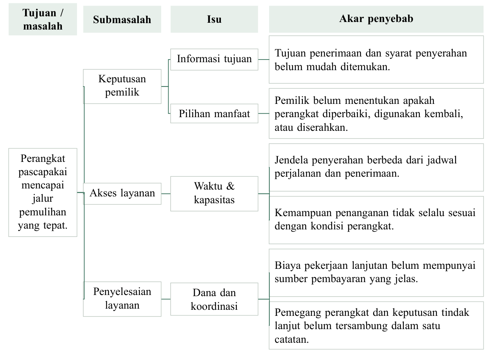

Input: `goal`, then `branches[]`. Each branch contains `subproblem` and `issues[]`; each issue contains `issue` and `causes[]`. A cause is text or an object with `text` and optional `citation`. Header labels are configurable with `goal_label`, `subproblem_label`, `issue_label`, `cause_label`.

The four-column reading order is goal/problem → subproblem → specific issue → root cause. A branch can contain multiple issues and an issue multiple causes. Orthogonal connectors keep sibling causes distinct. Row heights expand with label length. More than 12 leaves is rejected so the author splits an overloaded tree into linked exhibits. Keep source category and population next to the correct cause. A repair-intention percentage from household appliances is not a personal-laptop privacy finding. The gallery's leaves are hypotheses demonstrating geometry, not empirical evidence.

### 2. Operating and exception flow

[Input JSON](../skills/write-innovation-essays/assets/charts/examples/service_flow.json) · [Editable source](../skills/write-innovation-essays/assets/charts/templates/service_flow.tex) · [Vector PDF](../skills/write-innovation-essays/assets/charts/previews/service_flow.pdf)

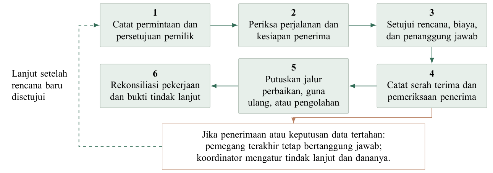

Input: six `stages`, optional `exception_from` (1–6), `exception_label`, and `resume_label`. The normal path reads across the upper row and returns across the lower row. A distinct held-case branch identifies the decision and responsibility that survives an interruption; its dashed return represents a newly approved continuation.

Use this to explain work, not every screen/button. If six stages conceal material alternatives or authorities, split the procedure and use a native decision table beside it. A line drawn back to the first stage does not itself authorize rebooking, payment, data sanitization or a new custodian. Those operating rules belong in the accompanying exhibit and narrative.

### 3. Stakeholder or organizational structure

[Input JSON](../skills/write-innovation-essays/assets/charts/examples/stakeholder_structure.json) · [Editable source](../skills/write-innovation-essays/assets/charts/templates/stakeholder_structure.tex) · [Vector PDF](../skills/write-innovation-essays/assets/charts/previews/stakeholder_structure.pdf)

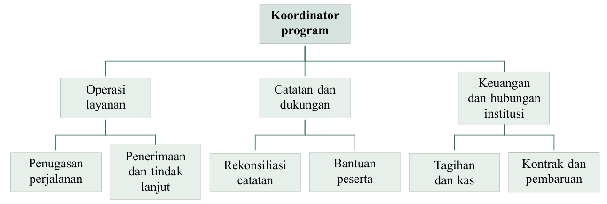

Input: `nodes[]` with unique `id`, `label` and `parent`; the single root has `parent: null`. The renderer rejects unknown parents, cycles, disconnected nodes, more than six leaves or an excessively deep structure. Node coordinates follow the child groups; edges stay behind the role boxes.

Use labels that name actual proposed responsibilities. Do not create a C-suite to make a small program look sophisticated. Distinguish a reporting line from a commercial relationship or decision right. Use RACI or a stakeholder influence table when those are the actual questions.

### 4. Competitor positioning

[Input JSON](../skills/write-innovation-essays/assets/charts/examples/positioning.json) · [Editable source](../skills/write-innovation-essays/assets/charts/templates/positioning.tex) · [Vector PDF](../skills/write-innovation-essays/assets/charts/previews/positioning.pdf)

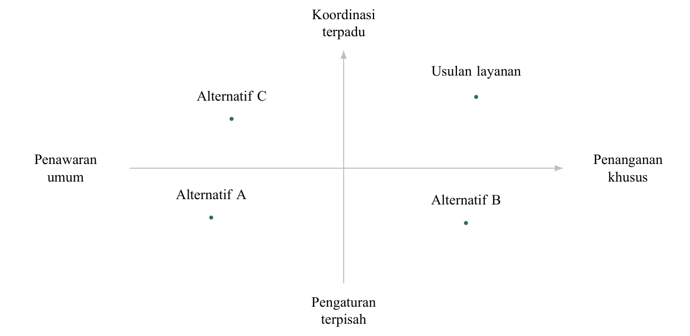

Input: `x_low`, `x_high`, `y_low`, `y_high`, and `points[]` containing `label`, `x`, `y`. Coordinates run from −1 to 1. `label_dx` and `label_dy` permit deliberate offsets after a visual check. Twelve points is the maximum.

Define axes by observable service attributes or a documented assessment rubric. Existing collection, repair or logistics organizations should receive fair credit; the proposal's point cannot be placed in a superior corner merely by assertion. The sample's Alternative A/B/C labels are invented examples, not ratings of real competitors. Do not read normalized coordinates as market share, quality scores or distance between capabilities without an explicit measurement method.

### 5. Value proposition canvas

[Input JSON](../skills/write-innovation-essays/assets/charts/examples/value_proposition.json) · [Editable source](../skills/write-innovation-essays/assets/charts/templates/value_proposition.tex) · [Vector PDF](../skills/write-innovation-essays/assets/charts/previews/value_proposition.pdf)

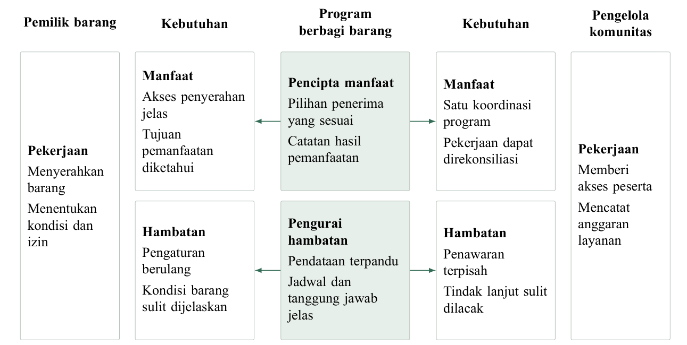

Input: `left` and `right` participants, each with `name`, `jobs`, `gains`, `pains`; `offer` contains `name`, `gain_creators`, `pain_relievers`. Each list has one to five concise items. Optional heading keys provide English or another language: `jobs_heading`, `gains_heading`, `pains_heading`, `needs_heading`, `gain_heading`, `pain_heading`.

The offer's concrete mechanisms connect to both participants' benefits and obstacles. Card heights adapt to content density; excessively dense canvases are rejected for revision. Keep jobs as actions, pains as obstacles, gains as valued outcomes, and offering mechanisms as functions. “Innovative”, “sustainable” and “trusted” do not substitute for an explanation of who receives what or why they participate.

### 6. TAM/SAM/SOM layers

[Input JSON](../skills/write-innovation-essays/assets/charts/examples/market_layers.json) · [Editable source](../skills/write-innovation-essays/assets/charts/templates/market_layers.tex) · [Vector PDF](../skills/write-innovation-essays/assets/charts/previews/market_layers.pdf)

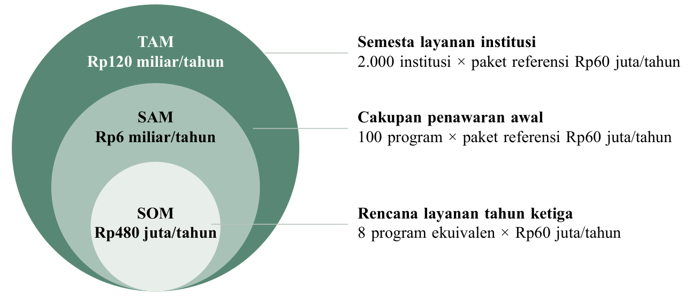

Input: exactly three `levels`, each with `label`, displayed `value`, `description`, `basis`; set `schematic: true`. The circles do not scale area to value. Right-side leader lines attach the labels to their respective layers.

Market units must match the product's actual payer and transaction. Institution service expenditure is different from the resale value of all electronics. State geography, eligibility, period, unit price and service volume. The renderer deliberately treats displayed money as text; it cannot verify a multiplication inside a label. Reconcile the market table and model separately. Put a brief schematic qualifier in the caption when shape areas could otherwise be misread.

### 7. Implementation Gantt

[Year-one input](../skills/write-innovation-essays/assets/charts/examples/gantt_year1.json) · [Strategic input](../skills/write-innovation-essays/assets/charts/examples/gantt_strategy.json) · [Year-one PDF](../skills/write-innovation-essays/assets/charts/previews/gantt_year1.pdf) · [Strategic PDF](../skills/write-innovation-essays/assets/charts/previews/gantt_strategy.pdf)

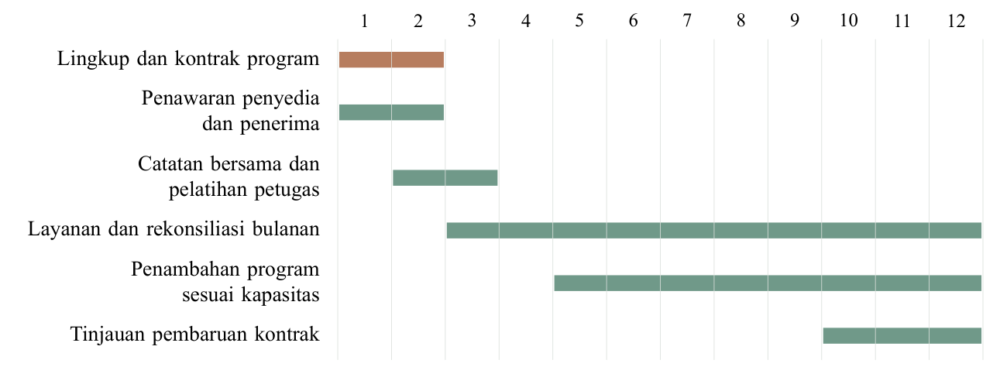

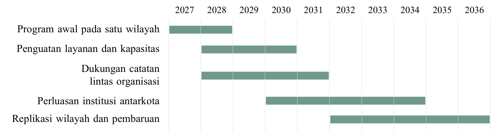

Input: `periods[]` and `tasks[]` with `label`, inclusive 1-based `start`, `end`, and optional `critical`. The engine allows 2–24 periods. The example includes a short commissioning schedule and a strategic horizon; these are two configurations of one family. Row heights follow the actual wrapped label boxes, so three-line task descriptions receive more vertical space and bars remain centered on their own labels. Period labels have bounded widths; use concise labels such as Jan/Q1/2028 rather than silently overlapping long month names.

Use actual months/years from the project brief. A ten-year horizon is not a universal requirement. Readiness, contracts, funding, category competence and receiving capacity must precede the promises that rely on them. Staffing and financial ramp-up should use the same dates. Bars show planned duration, not completion, a validated dependency network or secured participation. Add owners, dependencies and decision thresholds in a native table if required.

### 8. Risk heatmap

[Input JSON](../skills/write-innovation-essays/assets/charts/examples/risk_heatmap.json) · [Editable source](../skills/write-innovation-essays/assets/charts/templates/risk_heatmap.tex) · [Vector PDF](../skills/write-innovation-essays/assets/charts/previews/risk_heatmap.pdf)

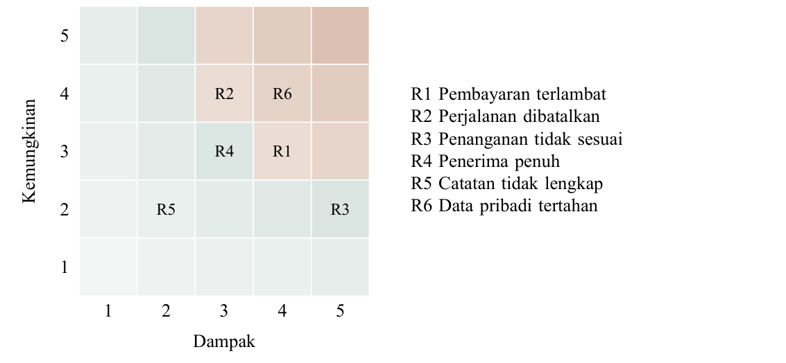

Input: `risks[]` with `id`, `probability` and `impact`, both integers 1–5. `legend`, `x_label` and `y_label` are configurable. Several IDs can share a cell; crowded cells are rejected rather than silently dropping a risk. Background tint follows the ordinal product.

The default represents initial ordinal positions. Do not caption it as both initial and residual risk unless the second positions are actually plotted. Keep every ID consistent with the risk register, where the trigger, owner, response, resource and residual target are defined. Numerical products prioritize review; they are not expected-loss calculations or probabilities of a safe outcome.

### 9. Comparable horizontal bars

[Input JSON](../skills/write-innovation-essays/assets/charts/examples/comparison.json) · [Editable source](../skills/write-innovation-essays/assets/charts/templates/comparison.tex) · [Vector PDF](../skills/write-innovation-essays/assets/charts/previews/comparison.pdf)

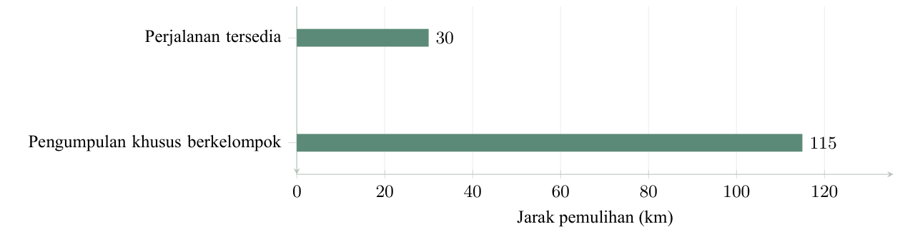

Input: `categories`, one to four `series`, each with `label` and same-length `values`, and `x_label` including units. The engine includes zero in the limits and preserves category order. Single-series plots omit a redundant legend; multiseries plots retain it.

Do not compare total costs when one option serves fewer people/items or excludes a handling step. First establish equal service scope and denominator. Distinguish additional distance on an existing journey from a dedicated route's total length. If an alternative exceeds the scenario budget, disclose that condition beside the comparison. Unit costs and actual service outcomes should not be combined into one ambiguous bar.

### 10. Cash or other time-series lines

[Input JSON](../skills/write-innovation-essays/assets/charts/examples/cash.json) · [Editable source](../skills/write-innovation-essays/assets/charts/templates/cash.tex) · [Vector PDF](../skills/write-innovation-essays/assets/charts/previews/cash.pdf)

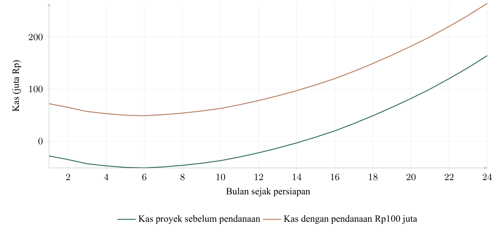

Input: strictly increasing numeric `periods`, one to four `series` of matching length, `x_label`, `y_label`. The values can be negative. No interpolation beyond straight segments or financial derivation is applied.

The example's two series differ by a stated capital injection. A funded balance is not project profitability. Keep opening investment, service receipts, billing/payment delay, taxes, reserves, financing, distributions and terminal value explicit in the model. Do not change a cash curve into accounting profit or investment NPV merely through a caption. The figure's unit label should match the financial schedules exactly.

### 11. Distribution of supplied draws

[Input JSON](../skills/write-innovation-essays/assets/charts/examples/npv_distribution.json) · [Editable source](../skills/write-innovation-essays/assets/charts/templates/npv_distribution.tex) · [Vector PDF](../skills/write-innovation-essays/assets/charts/previews/npv_distribution.pdf)

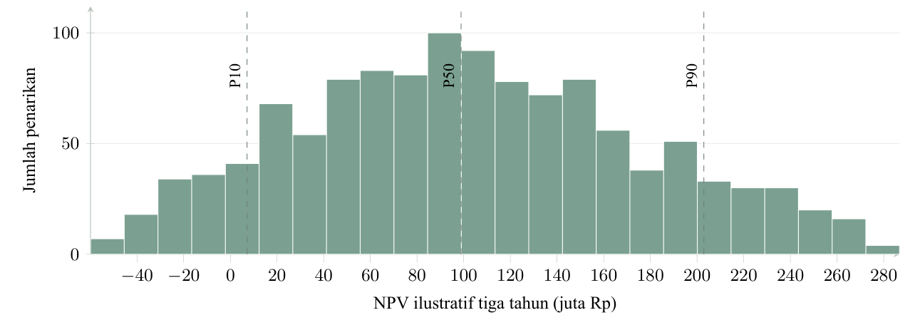

Input: `values[]`, `bins` (4–60), axis labels and optional `show_quantiles`. Values are binned with the upper endpoint included in the final bin. P10/P50/P90 use linear percentile interpolation over the sorted input. The metadata retains count, bin counts and quantiles. Equal-valued inputs receive a small plotting range; no variability is invented in the statistics.

The gallery contains 1,200 illustrative triangular draws supplied as data. A real Monte Carlo appendix should disclose actual distributions, correlations/dependencies, draw order, seed, horizon, cash conventions, sample count and stability checks. A positive-NPV frequency is conditional on those assumptions, not a measured probability of market success. Choose Monte Carlo because a joint uncertainty matters to a decision; a single credible sensitivity table can be more useful than an unsupported simulation.

### 12. Driver associations

[Input JSON](../skills/write-innovation-essays/assets/charts/examples/drivers.json) · [Editable source](../skills/write-innovation-essays/assets/charts/templates/drivers.tex) · [Vector PDF](../skills/write-innovation-essays/assets/charts/previews/drivers.pdf)

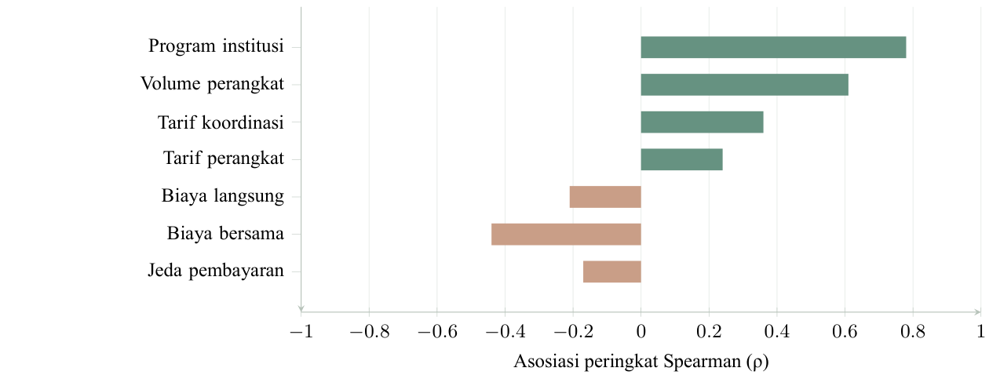

Input: `labels`, same-length `values` between −1 and 1, and `x_label`. Positive and negative associations use restrained different fills. The engine does not sort, estimate or compute the associations; retain the intended ranking and provide the statistical calculation separately.

Use this to explain which input improvements are most decision-relevant under a simulation. An association may reflect shared input factors or model structure. It does not establish how changing a real-world policy will causally change an outcome. The example's associations are independent illustrative inputs, not results derived from the gallery's histogram values.

## Integrating figures with a Word essay

1. Select the exhibit because its answer supports a particular sentence or decision.
2. Keep main argument, headline result and necessary interpretation in native essay prose.
3. Insert the PNG at a measured width; retain the vector PDF and editable TEX in the project archive.
4. Add a short descriptive caption in Word. Put units on the axis or in the table, and source/assumption scope beside the exhibit where needed.
5. Use the document engine's actual bookmarks and sentence-specific appendix references. Add a visible return to the relevant essay section and index.
6. Keep image and caption together, but do not keep an entire long appendix as one unsplittable block.
7. Inspect the exported document at its actual page size. Increase space or split the exhibit if type, prices, constraints, risk IDs or source details are unreadable.

Example caption: **Gambar 4. Tambahan jarak untuk beban layanan yang sama.** A compact qualifier may state that data are a constructed scenario and the graph excludes full organizational costs. Avoid a slide-style title, “key takeaway” banner, internal upload filename, tool credit or paragraph explaining that a chart was created.

## Verification and failure handling

The shipped examples were compiled with a real TeX engine and converted into complete PNGs. A separate [long-label Gantt stress input](../skills/write-innovation-essays/assets/charts/stress/long-gantt.json) and its actual rendered files are retained under `assets/charts/stress/`; the review checked ordinary 94–97-character Indonesian task descriptions after adaptive row spacing. Compilation failures, missing glyphs, and overfull text boxes wider than 1 pt stop the export. Output metadata records underfull/other compiler warnings for inspection. An error message is not permission to silently shrink below readability or replace a required font.

The meaningful checks are: numeric input preservation; bar baseline and denominators; histogram counts summing to input count; line-series length/order; integer Gantt bounds; risk range/IDs; structure consistency; literal TeX escaping; actual PDF page bounds; PNG integrity; and visual inspection of the final figure at placed size. Mechanical success is not proof that a causal tree is evidenced, a market is attainable, an ordinal rating is objective or a financial forecast is investable.

The generator disables TeX shell escape and treats labels as literal text. Keep untrusted downloaded TeX separate from trusted templates and inspect it before compiling; a repository's presence is not permission to run arbitrary setup code. The toolkit's original reference archive is for reading and provenance, not automatic executable content.
