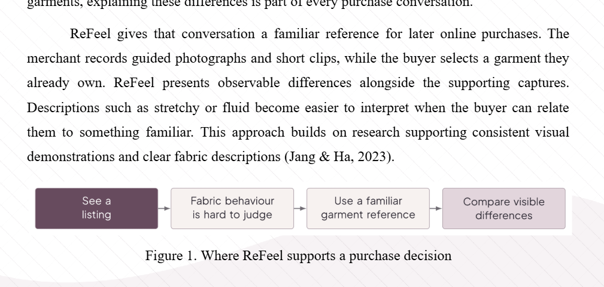
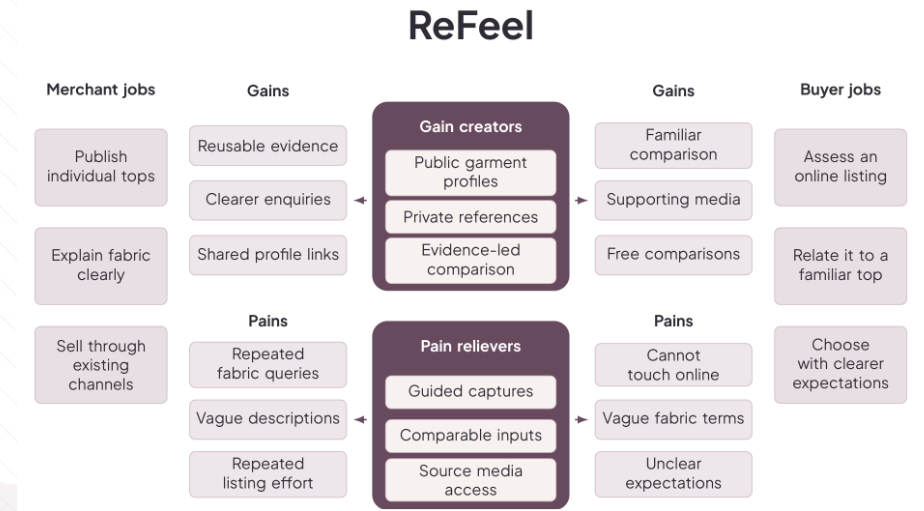
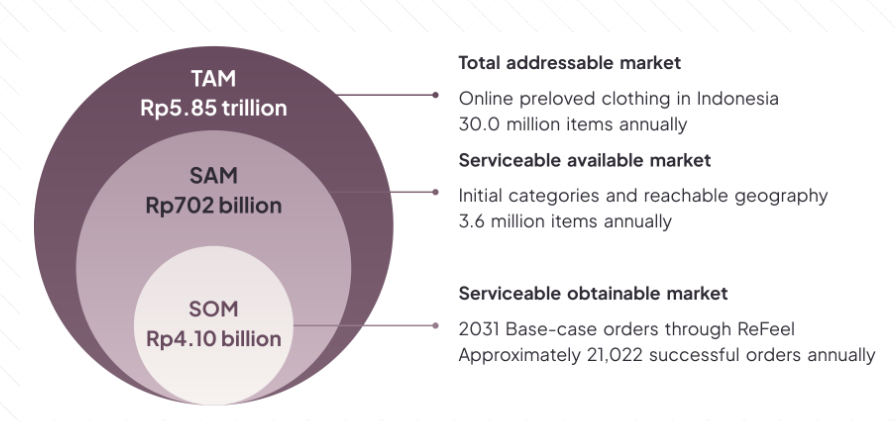
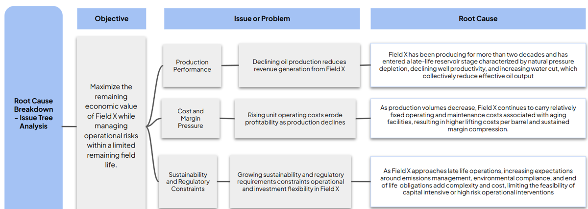
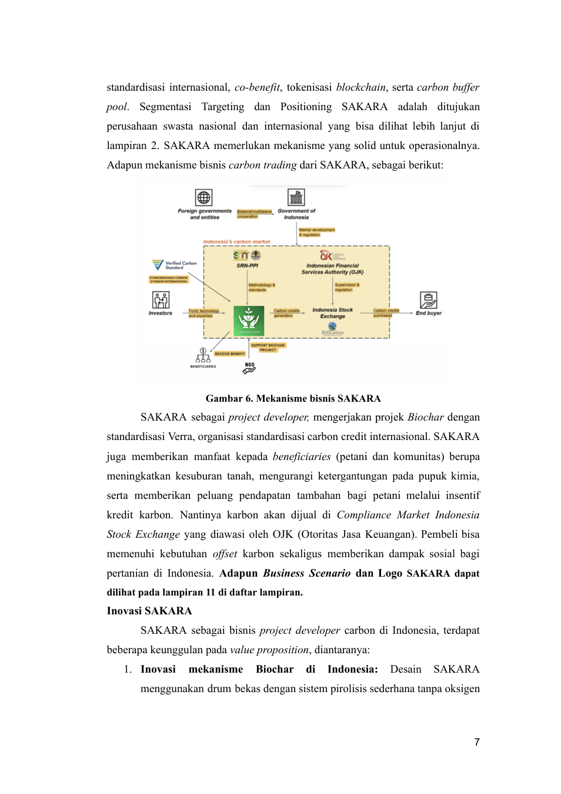
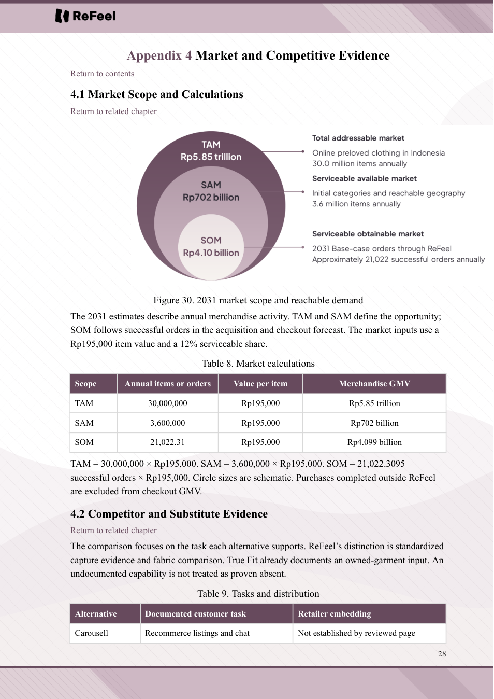
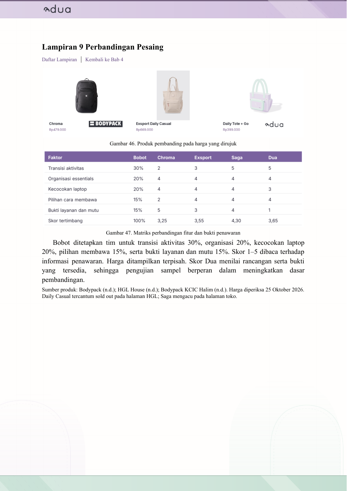
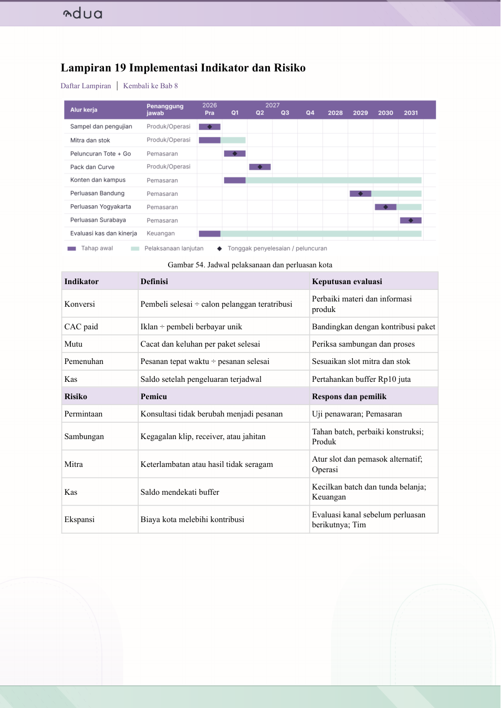
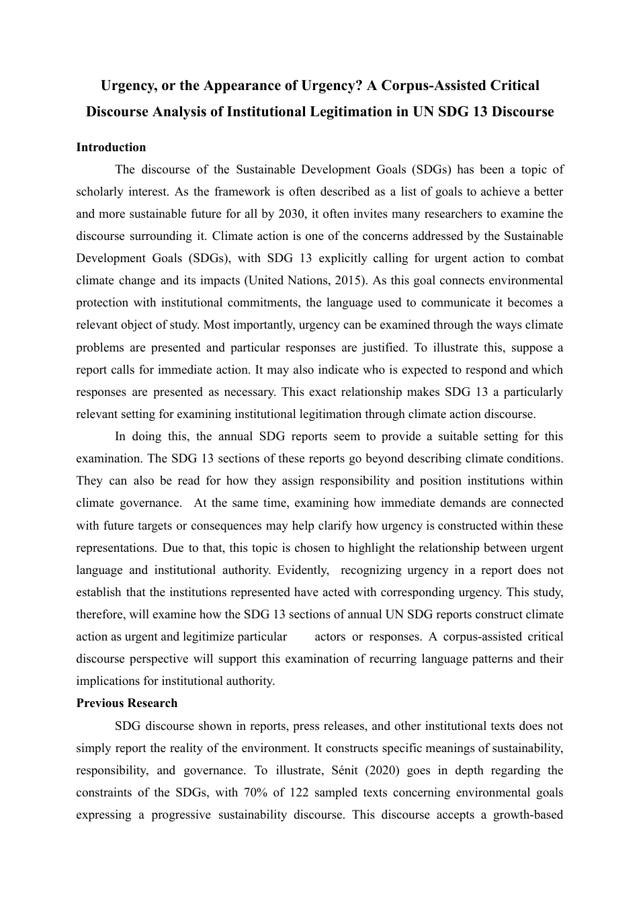

# Reference atlas

This atlas is a visual route into the private source library. It uses actual supplied reference images and faithful PDF page renders. Preview copies are not new figures for submission. Full originals, source hashes and identities remain in [the catalog](../library/catalog.md) and `library/source-manifest.json`.

## Contents

- [The author’s analytical taste](#the-authors-analytical-taste)
- [Essay argument and operating flow](#essay-argument-and-operating-flow)
- [Business-plan exhibits](#business-plan-exhibits)
- [Writing cadence](#writing-cadence)
- [How to use the atlas](#how-to-use-the-atlas)

## The author’s analytical taste

[All thirteen supplied taste examples](../assets/reference-previews/taste-contact-sheet.jpg) · [Detailed learning notes](../library/lessons/visual-references.md)

### A service located in one decision

The four-step strip earns its place by showing where the service changes a purchase decision. It follows a paragraph instead of replacing the paragraph’s argument. Transfer the short decision chain and hierarchy. Write the new task’s own labels and retain a meaningful caption.

### Participant value organized around the service

Each side has jobs, gains and pains that meet around the offering. This is useful when two participant groups need different reasons to participate. A new diagram should preserve that causal relationship; filling a canvas with generic “trust”, “easy” and “sustainable” text adds little.

### A market boundary and its explanation

The source uses nested shapes, leader lines and disciplined color rather than a slide headline. Its circles are schematic, not area-proportional. A new market exhibit must retain annual/cumulative basis, geography, year, units and the calculation behind each level. The source values are not a reusable market estimate.

### A horizontal problem tree

The reading order is explicit: objective → problem dimension → issue → root cause. The layout permits more than one child per problem. The original screenshot does not provide sources for its leaves. The separate green sample mixes oilfield and matcha content; [the learning note](../library/lessons/visual-references.md#a-beautiful-issue-tree-still-needs-a-valid-causal-argument) explains why only its geometry transfers.

## Essay argument and operating flow

[Selected actual corpus pages — contact sheet](../assets/reference-previews/corpus-selection-contact-sheet.jpg)

These pages were selected from the already-read corpus and inspected again for this atlas. Source locators are physical PDF pages, not printed page numbers. Open the original for a complete reading before making a new source-content claim.

| Actual page | Why open it | Full preview |
|---|---|---|
| FISHEE.ID, corpus04, physical p.4 | Sector/background begins narrowing toward local finance/distribution barriers. Follow across the next pages; do not copy its broad pandemic-definition preamble or override the current rule on solution timing. | [Opening page](../assets/reference-previews/fishee-opening.png) |
| FISHEE.ID, corpus04, physical p.9 | One transaction is explained through funds, production, sale and allocation. Learn the shared sequence and obligations. | [Transaction page](../assets/reference-previews/fishee-transaction.png) |
| Jakarta Smart Island, corpus08, physical p.4 | Whole-system/site and material-flow explanation precedes detailed capacities. The source’s large scale is not a new project assumption. | [System page](../assets/reference-previews/jakarta-system.png) |
| SOLVAEROPHIL, corpus11, physical p.5 | Specific operating/parameter statements call the appendix that supports them. Do not treat its test claims as the new team’s evidence. | [Appendix-call page](../assets/reference-previews/solvaerophil-appendix-calls.png) |
| SAKARA, corpus37, physical p.7 | The business mechanism joins the participants and the work. Read the text around the figure instead of borrowing its sector facts. | [Business-flow page](../assets/reference-previews/sakara-business-flow.png) |
| Citizen Charter in corpus32, physical p.94 | Governance commitments become an actor/response arrangement. Its cited effectiveness percentage is a source claim, not JejakBalik or new-project evidence. | [Institutional-response page](../assets/reference-previews/citizen-charter.png) |

The useful move is the relationship between the explanation and its mechanism. Dense BMC/technical microtext elsewhere in the source has recorded resolution limits. A diagram’s professional appearance never makes all of its claims independently checked.

## Business-plan exhibits

ReFeel and Dua were supplied specifically for analytical design and the use of conceptual imagery. Their long business-plan structures should not dictate a five-page essay. Detailed interpretation and original-file reading routes are in [user-supplied models](../library/lessons/user-models.md).

### ReFeel: exhibit, calculation and scope together

This page keeps the schematic figure beside a calculation table and explains the difference between market opportunity and forecast successful orders. In a new document, use native tables for the calculation and TikZ for the nesting when appropriate. Current black-text rules override the sample’s colored heading/banner treatment.

[ReFeel detailed service workflow, physical p.40](../assets/reference-previews/refeel-service-workflow.png) shows where an existing sales channel sits in the flow. Preserve a whole-service view before drilling into individual operations.

### Dua: a comparison that does not automatically favor its own design

The own-product rating and total are not highest on every basis. That makes the comparison more useful than a matrix designed to guarantee a win. Reuse the evidence-aware comparison logic and recreate it with current alternative data; do not reuse source prices or scores.

### Dua: implementation has owners and decision rules

The chart and tables connect work, owner, milestone, measure and response. A new programme needs its own capacities, calendar and resources. Both a detailed first-year Gantt and a long strategic horizon are useful when the decisions differ; ten years is not a universal requirement.

## Writing cadence

The subject evolves from SDG discourse into urgency and institutional responsibility, then into the author’s analytical question. Connectors perform a relationship already being developed. Do not imitate cadence by inserting the same connector every paragraph or mechanically ending every paragraph with a verdict. The source is a research paper; a developed innovation essay still needs an intelligible operating arrangement and implementation argument.

Nostalgia and The Nexus Point are additional authorial-interpretation routes: [read the selection guide](../library/reading-routes.md#choose-references-by-the-drafts-problem). Their DOCX originals remain in the complete archive.

## How to use the atlas

1. Name the draft defect or reader question before selecting a model.
2. Open the actual original and read the chosen document completely; thumbnails are navigation aids.
3. Record the useful move in ordinary language: what changes, who acts, what follows and why.
4. Recreate the structure using the current project’s sources, values and authorial position.
5. Render the new document at its intended size and inspect it. A beautiful source or correct chart source code does not prove a readable final exhibit.

Preview provenance is machine-readable in `assets/reference-previews/preview-manifest.json` and `taste-manifest.json`. Originals have not been retouched to repair source claims, missing text or arithmetic. The full archive remains private as requested.
